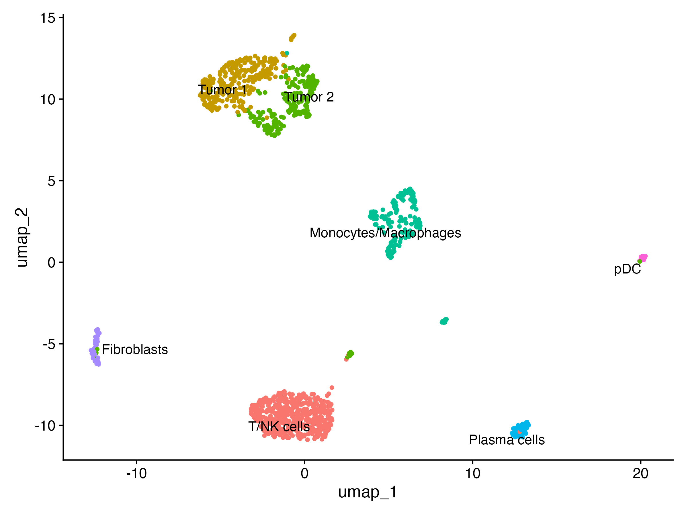

# Single-Cell RNA-seq Analysis of NSCLC (Seurat v5)

End-to-end scRNA-seq analysis of Non-Small Cell Lung Cancer (NSCLC) using **R** and **Seurat v5**.

## Data
10x Genomics **20k NSCLC DTC 3' (Next GEM), donor 1** public dataset.
Download [`20k_NSCLC_DTC_3p_nextgem_donor_1_count_sample_feature_bc_matrix.h5`](https://cf.10xgenomics.com/samples/cell-exp/6.1.2/20k_NSCLC_DTC_3p_nextgem_donor_1/20k_NSCLC_DTC_3p_nextgem_donor_1_count_sample_feature_bc_matrix.h5) from 10x Genomics and place it in the main folder before running the script.
## Workflow
1. **Quality control:** filtering by `nFeature_RNA`, `nCount_RNA` and `percent.mt`.
2. **Normalization and scaling:** log-normalization and 2000 highly variable genes.
3. **Dimensionality reduction and clustering:** PCA, elbow plot, graph-based clustering (resolution 0.3) and UMAP.
4. **Annotation:** T/NK cells, Tumor cells, Monocytes/Macrophages, Plasma cells, Fibroblasts and pDCs.

## Result


## Repository structure
- `scripts/`: the R analysis script.
- `results/plots/`: QC, PCA, UMAP and marker plots.
- `results/tables/`: marker genes and cell type counts.
- `results/sessionInfo.txt`: R and package versions.

## How to run
From the main folder:
```bash
Rscript scripts/scRNA_seq_analysis.R
```

## Environment
R 4.6.1, Seurat 5.5.1 (see `results/sessionInfo.txt` for the full list).
